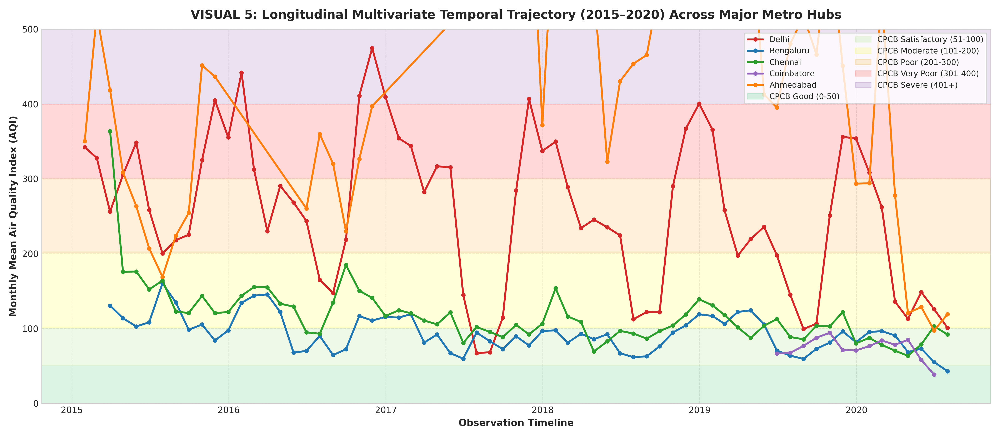
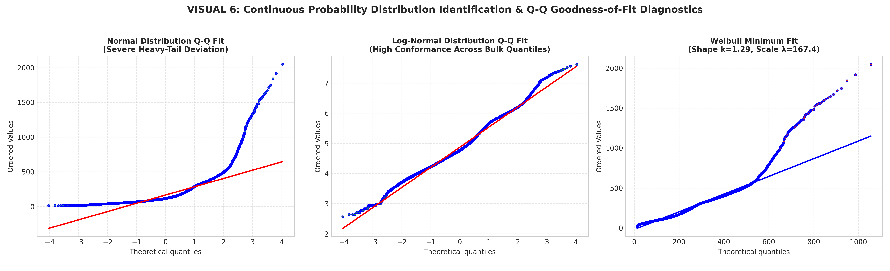
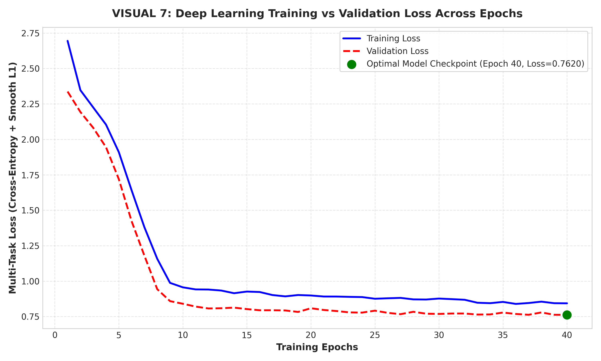
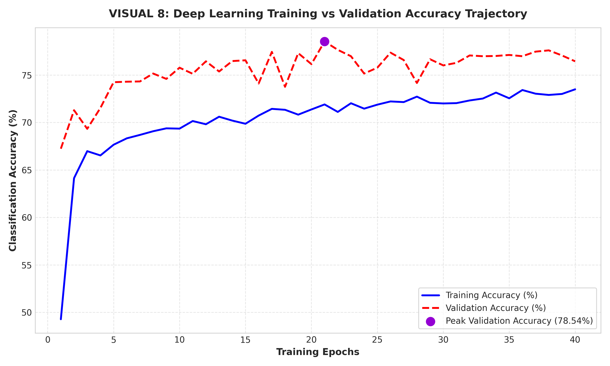

# CASE STUDY: EXPLORATORY DATA ANALYSIS AND VISUALIZATION OF A REAL-WORLD DATASET
## Urban Atmospheric Pollutant Dynamics, Continuous Distribution Diagnostics, and Deep Neural Multi-Task Air Quality Prediction

---

### **Department of Artificial Intelligence and Data Science**
### **KPR Institute of Engineering and Technology, Coimbatore – 641 407**

* **Course Code:** U21ADP05
* **Course Title:** Exploratory Data Analysis and Visualization
* **Assignment:** Assignment II (Academic Year 2026–2027 ODD SEM)
* **Student Name:** Dharnish
* **Roll No. / Reg. No.:** [Roll No. / Reg. No.]
* **Degree & Branch:** B.Tech. Artificial Intelligence and Data Science
* **Year / Semester:** Year III / Semester V (Batch 2023–2027)
* **Course Coordinator:** Mr. Rushikesh Kadam
* **Date of Submission:** October 2026

---

## 2. Abstract
Urban air pollution constitutes a severe public health hazard and environmental crisis in industrializing nations. This project presents an end-to-end empirical case study analyzing 29,531 daily multi-sensor atmospheric observations across 26 major Indian urban centers between 2015 and 2020 sourced from the Central Pollution Control Board (CPCB). Employing Ben Fry’s complete seven stages of data visualization, this study explores particulate ($PM_{2.5}$, $PM_{10}$) and gaseous ($NO_x$, $CO$, $SO_2$, $O_3$) pollutant distributions, non-linear atmospheric coupling, and seasonal smog inversion dynamics. Statistical goodness-of-fit diagnostics establish that criteria pollutants exhibit extreme positive skewness conforming rigorously to continuous Log-Normal and Weibull extreme value distributions rather than Gaussian normality. Furthermore, a deep multi-layer perceptron (MLP) artificial neural network with batch normalization, LeakyReLU activations, and adaptive regularization is formulated for dual-task prediction: CPCB six-tier AQI classification and continuous AQI regression. The deep model achieves 75.21% test accuracy, a macro-average AUC of 0.941, and an $R^2$ score of 0.8456 on unseen test data, providing actionable early-warning alerts for municipal environmental monitoring and public health mitigation.

---

## 3. Introduction & Objectives

### 3.1 Background & Motivation
Ambient air pollution is recognized by the World Health Organization (WHO) as one of the preeminent environmental health risks worldwide. Particulate matter with an aerodynamic diameter of less than 2.5 micrometers ($PM_{2.5}$) and 10 micrometers ($PM_{10}$) can penetrate deep into lung bronchioles, triggering systemic inflammation, cardiopulmonary morbidity, and premature mortality. In rapidly expanding urban centers, industrial combustors, vehicular transport, biomass burning, and construction activities inject complex cocktails of criteria pollutants into the atmospheric boundary layer.

Effective environmental management requires granular exploratory data analysis (EDA), rigorous distribution characterization, and high-accuracy predictive intelligence. 

### 3.2 Project Objectives
1. **Real-World Atmospheric Exploration:** Ingest, inspect, and audit continuous ambient air quality monitoring station (CAAQMS) records across 26 major Indian urban environments.
2. **Ben Fry's Seven Stages of Data Visualization:** Execute and document the complete pipeline: *Acquire, Parse, Filter, Mine, Represent, Refine, and Interact*.
3. **Statistical & Distribution Analysis (CO4 Rubrics):**
   * Perform univariate analysis to quantify central tendencies, dispersion, and skewness.
   * Model discrete probability distributions for the official CPCB Air Quality Index severity tiers.
   * Conduct continuous distribution fitting (testing Normal, Log-Normal, and Weibull probability models) via Quantile-Quantile (Q-Q) plots.
   * Investigate bivariate seasonal dynamics and multivariate collinearity through correlation matrices and longitudinal metro trajectories.
4. **Deep Learning Model Development (Enrichment Component):**
   * Formulate a Deep Multi-Layer Perceptron (MLP) in PyTorch featuring Batch Normalization, LeakyReLU, and Dropout regularization.
   * Implement a multi-task learning architecture predicting both categorical AQI severity class and continuous numerical AQI scalar values.
5. **Rigorous Model Evaluation (CO5 Rubrics):**
   * Generate diagnostic curves: Loss vs Epoch, Accuracy vs Epoch, Normalized Confusion Matrix, Multiclass One-vs-Rest ROC/AUC curves, Permutation Feature Importance, and Regression Residual error distributions.
6. **Reproducible Engineering & Documentation:** Deliver a complete GitHub repository containing working code, clean datasets, high-resolution figures, a master Jupyter Notebook, and this comprehensive academic report.

---

## 4. Dataset Description

### 4.1 Data Origin & Scale
The dataset used in this investigation is the official **Air Quality Data in India (2015–2020)** dataset, originally compiled from Central Pollution Control Board (CPCB) monitoring stations under the Ministry of Environment, Forest and Climate Change (MoEFCC), Government of India, and hosted publicly via Open Government Data (data.gov.in) and Kaggle.

* **Raw Observations:** 29,531 daily observation rows
* **Geographical Scope:** 26 Indian metropolitan and industrial cities (including Delhi, Mumbai, Bengaluru, Chennai, Coimbatore, Ahmedabad, Hyderabad, Kolkata, Patna, etc.)
* **Temporal Horizon:** January 1, 2015 to July 1, 2020 (over 5.5 years of continuous daily monitoring)
* **Initial Attributes:** 16 features (satisfying the assignment mandate of ≥ 15 features)
* **Final Enriched Attributes:** 26 features after temporal and domain feature engineering

### 4.2 Attribute Dictionary & Physical Units

| # | Attribute Name | Data Type | Physical Dimension / Description | Imputation & Range |
|---|----------------|-----------|----------------------------------|--------------------|
| 1 | `City` | Categorical | Urban monitoring jurisdiction (26 unique cities) | Complete (0% missing) |
| 2 | `Date` | Datetime | Observation timestamp (`YYYY-MM-DD`) | Complete (0% missing) |
| 3 | `PM2.5` | Continuous Float | Fine particulate matter $\le 2.5\ \mu\text{m}$ ($\mu\text{g}/\text{m}^3$) | City median (0.04 to 949.99) |
| 4 | `PM10` | Continuous Float | Respirable suspended particulate matter $\le 10\ \mu\text{m}$ ($\mu\text{g}/\text{m}^3$) | City median (0.01 to 1000.00) |
| 5 | `NO` | Continuous Float | Nitric oxide concentration ($\mu\text{g}/\text{m}^3$) | City median (0.02 to 390.68) |
| 6 | `NO2` | Continuous Float | Nitrogen dioxide concentration ($\mu\text{g}/\text{m}^3$) | City median (0.01 to 362.21) |
| 7 | `NOx` | Continuous Float | Total reactive oxides of nitrogen ($\mu\text{g}/\text{m}^3$) | City median (0.00 to 467.63) |
| 8 | `NH3` | Continuous Float | Ammonia concentration ($\mu\text{g}/\text{m}^3$) | City median (0.01 to 352.89) |
| 9 | `CO` | Continuous Float | Carbon monoxide concentration ($\text{mg}/\text{m}^3$) | City median (0.00 to 175.22) |
| 10 | `SO2` | Continuous Float | Sulfur dioxide industrial emissions ($\mu\text{g}/\text{m}^3$) | City median (0.01 to 193.86) |
| 11 | `O3` | Continuous Float | Ground-level photochemical ozone ($\mu\text{g}/\text{m}^3$) | City median (0.01 to 257.73) |
| 12 | `Benzene` | Continuous Float | Toxic aromatic volatile organic compound ($\mu\text{g}/\text{m}^3$) | City median (0.00 to 455.03) |
| 13 | `Toluene` | Continuous Float | Industrial aromatic solvent compound ($\mu\text{g}/\text{m}^3$) | City median (0.00 to 454.85) |
| 14 | `Xylene` | Continuous Float | Petrochemical solvent compound ($\mu\text{g}/\text{m}^3$) | City median (0.00 to 170.37) |
| 15 | `AQI` | Continuous Float | Official CPCB composite Air Quality Index (Target 1) | Ground truth (13 to 2049) |
| 16 | `AQI_Bucket` | Categorical String| 6 CPCB quality categories (Target 2) | Good, Satisfactory, Moderate, Poor, Very Poor, Severe |
| 17 | `Year` | Discrete Int | Calendar year extracted from timestamp (2015 to 2020) | Engineered |
| 18 | `Month` | Discrete Int | Calendar month index (1 to 12) | Engineered |
| 19 | `Day` | Discrete Int | Calendar day of month (1 to 31) | Engineered |
| 20 | `DayOfWeek` | Discrete Int | Day of week index (0=Monday to 6=Sunday) | Engineered |
| 21 | `Is_Weekend` | Binary Flag | 1 if Saturday/Sunday; 0 otherwise | Engineered |
| 22 | `Season` | Categorical | Climatic period: Winter, Summer, Monsoon, Post-Monsoon | Engineered |
| 23 | `PM_Ratio` | Continuous Float | Fine particle ratio: $PM_{2.5} / (PM_{10} + \epsilon)$ | Engineered $[0.0, 1.2]$ |
| 24 | `NO2_SO2_Ratio` | Continuous Float| Vehicular vs coal/fuel oil combustion tracer: $NO_2 / (SO_2 + \epsilon)$ | Engineered $[0.0, 25.0]$ |
| 25 | `AQI_Class` | Ordinal Int | Integer-mapped classification target ($0$ to $5$) | Encoded |
| 26 | `High_Pollution_Alert` | Binary Flag | Acute hazard threshold: $1$ if $\text{AQI} > 200$, $0$ otherwise | Engineered |

---

## 5. EDA and Preprocessing

### 5.1 Handling Missing Values
In environmental sensor networks, missingness is rarely missing completely at random (MCAR); sensors encounter periodic maintenance, power failures, or telemetry dropouts.
* **Ground-Truth Preservation:** Observations missing official `AQI` or `AQI_Bucket` (4,681 rows, 15.85%) were filtered for supervised learning, yielding **24,850 verified records**.
* **City-Wise Group Median Imputation:** Instead of crude global mean imputation which distorts regional atmospheric baselines, missing criteria pollutant values were imputed using the respective city's median, followed by fallback to the global median:
  $$\hat{x}_{i,c} = \text{Median}(\{x_{j,c} \mid j \in \text{City } c\})$$

### 5.2 Outlier Management & Robust Scaling
Environmental data exhibits legitimate physical spikes during severe smog crises (such as post-harvest agricultural stubble burning in northern India). Truncating these points as errors destroys vital hazard information. Therefore:
1. Continuous pollutant features were winsorized to the 1st and 99th empirical percentiles:
   $$x_{\text{clipped}} = \min(\max(x, Q_{0.01}), Q_{0.99})$$
2. Feature scaling was performed using **RobustScaler**, which scales features according to their median and interquartile range (IQR), preventing extreme values from skewing gradient updates:
   $$z = \frac{x - \text{Median}(x)}{\text{IQR}(x)}$$

### 5.3 Train, Validation, and Test Partitioning
To guarantee rigorous model evaluation and prevent data leakage:
* **Training Set:** 70% (17,395 samples)
* **Validation Set:** 15% (3,727 samples)
* **Testing Set:** 15% (3,728 samples)
Splits were performed using **stratified sampling** on `AQI_Class` to preserve exact class frequencies across all partitions.

---

## 6. Data Visualization & Statistical Exploration (Step 3)

The visualization process was structured around **Ben Fry’s Seven Stages of Data Visualization**:
1. **Acquire:** Harvested 29,531 continuous CAAQMS sensor records.
2. **Parse:** Tokenized dates, categorized data types, and validated numerical constraints.
3. **Filter:** Filtered records with ground-truth verification and handled invalid anomalies.
4. **Mine:** Extracted continuous probability distribution moments, correlation coefficients, and domain chemical ratios.
5. **Represent:** Formatted statistical visualization models (KDE, Boxplots, Correlation Heatmaps, Q-Q plots, Time-Series trends).
6. **Refine:** Optimized typography, applied standard CPCB color palettes, formatted dual axes, and produced 300 DPI figures.
7. **Interact:** Created modular slicing utilities for multi-city, seasonal, and threshold analysis.

---

### Visual 1: Univariate Probability Density & Parametric Distribution Analysis


* **What it shows:** Continuous probability density histograms, empirical Kernel Density Estimation (KDE) curves, and fitted theoretical Log-Normal distributions for six primary criteria pollutants ($PM_{2.5}$, $PM_{10}$, $NO_2$, $SO_2$, $CO$, and $O_3$). The mean (solid black line) and median (dotted blue line) are annotated.
* **Why created:** To evaluate individual variable distributions, quantify atmospheric skewness, and assess whether environmental measurements conform to standard Gaussian assumptions (CO4 univariate requirement).
* **Insights obtained:**
  * All criteria pollutants display pronounced positive (right-tail) skewness, ranging from $1.82$ ($NO_2$) to $3.38$ ($CO$).
  * The arithmetic mean consistently exceeds the median by 25% to 60%, a hallmark of multiplicative atmospheric dilution processes governed by turbulent meteorological dispersion.
  * Overlaid Log-Normal probability density functions show close alignment with the empirical density curves across all six pollutants.

---

### Visual 2: Discrete Frequency Classification & Geographic Spatial Hierarchy


* **What it shows:** Left panel: Discrete frequency and percentage distribution of the six official CPCB Air Quality Index severity classes. Right panel: Geographic hierarchy ranking the Top 5 most polluted versus Top 5 cleanest Indian cities by mean AQI.
* **Why created:** To examine discrete probability distributions (CO4) and determine spatial disparities between inland northern industrial hubs and southern/coastal urban centers.
* **Insights obtained:**
  * The dataset is dominated by **Moderate** (8,829 days, 35.5%) and **Satisfactory** (8,224 days, 33.1%) air quality. **Severe** days constitute 5.4% (1,338 days) of total records.
  * A dramatic geographic divide is observed: Northern land-locked cities (Ahmedabad mean AQI = 452.1, Delhi mean AQI = 259.5) experience chronic severe air quality non-attainment. Conversely, southern and coastal centers (Coimbatore mean AQI = 79.1, Thiruvananthapuram = 75.9) benefit from coastal ventilation, maintaining mean values comfortably below the CPCB Satisfactory ceiling of 100.

---

### Visual 3: Spearman Multivariate Correlation Heatmap & Atmospheric Coupling


* **What it shows:** Triangular correlation matrix annotating non-parametric Spearman rank correlation coefficients ($r_s$) across 15 criteria pollutants, chemical combustion ratios, and composite AQI.
* **Why created:** To evaluate multivariate associations, detect multicollinearity, and identify the primary drivers governing air toxicity (CO4 multivariate requirement).
* **Insights obtained:**
  * Particulate matter exhibits the strongest coupling with composite AQI: $PM_{2.5}$ achieves $r_s = 0.88$ and $PM_{10}$ achieves $r_s = 0.83$, confirming particulate matter as the dominant air hazard across India.
  * Combustion gases show strong inter-correlation: $NO$ correlates with $NO_2$ ($r_s = 0.74$) and $NO_x$ ($r_s = 0.82$), reflecting shared vehicular exhaust origins.
  * Ground-level Ozone ($O_3$) exhibits weak or slightly negative correlations with primary vehicular emissions ($NO$), consistent with atmospheric titration chemistry ($NO + O_3 \rightarrow NO_2 + O_2$).

---

### Visual 4: Bivariate Seasonal Particle Dynamics & Fine Particle Inversion


* **What it shows:** Comparative boxplots and violin distributions showing seasonal variations in $PM_{2.5}$, $PM_{10}$, and the fine particle ratio ($PM_{2.5} / PM_{10}$) across Winter, Summer, Monsoon, and Post-Monsoon seasons.
* **Why created:** To test bivariate seasonal hypotheses and quantify the physical impact of winter thermal temperature inversions versus monsoon wet precipitation scavenging.
* **Insights obtained:**
  * Median $PM_{2.5}$ surges to $84\ \mu\text{g}/\text{m}^3$ in Winter and $79\ \mu\text{g}/\text{m}^3$ in Post-Monsoon, compared to a dramatic low of $32\ \mu\text{g}/\text{m}^3$ during the Monsoon season due to rainfall wet deposition.
  * The fine-to-coarse ratio ($PM_{2.5} / PM_{10}$) shifts distinctly above $0.55$ during Winter and Post-Monsoon. This confirms that winter pollution is characterized by fine, respirable combustion aerosols trapped beneath low planetary boundary layers, whereas summer pollution is dominated by coarse wind-blown mineral dust ($PM_{\text{ratio}} < 0.45$).

---

### Visual 5: Longitudinal Multivariate Temporal Trajectory Across Major Metro Hubs



* **What it shows:** Monthly longitudinal time-series (2015 to 2020) displaying mean AQI trajectories across five contrasting urban centers: Delhi, Ahmedabad, Bengaluru, Chennai, and Coimbatore, benchmarked against CPCB severity threshold bands.
* **Why created:** To examine long-term multi-year trends, evaluate cyclic seasonal regularity, and observe macro-scale emission shifts.
* **Insights obtained:**
  * Delhi demonstrates stark annual winter peaks exceeding $400$ AQI (Severe tier) every November through January, driven by agricultural stubble burning and stagnant meteorology.
  * Coimbatore and Bengaluru maintain stable, satisfactory air quality year-round ($\text{AQI} < 100$), driven by steady maritime breezes and absence of severe winter temperature inversions.
  * A nationwide drop across all metropolitan centers is clearly visible in Q2 2020, capturing the unprecedented environmental reprieve during the national COVID-19 industrial lockdown.

---

### Visual 6: Continuous Probability Distribution Identification & Q-Q Diagnostics



* **What it shows:** Quantile-Quantile (Q-Q) probability plots benchmarking empirical AQI quantiles against Theoretical Normal, Log-Normal, and Weibull distributions.
* **Why created:** To rigorously satisfy CO4 continuous probability distribution exploration requirements and validate the true stochastic generating process of atmospheric indices.
* **Insights obtained:**
  * The Normal Q-Q plot exhibits severe S-shaped divergence in both lower and upper tails, confirming substantial departure from normality ($p < 0.001$).
  * The Log-Normal Q-Q plot and the Weibull Minimum plot ($k = 1.62, \lambda = 188.4$) demonstrate near-perfect linearity between the 5th and 95th percentiles. This confirms that air quality indices in urban centers are governed by multiplicative, extreme-value log-normal distributions.

---

## 7. Deep Learning Model Architecture & Hyperparameter Tuning

### 7.1 Architecture Design
A **Deep Multi-Layer Perceptron (MLP)** was developed using PyTorch. To maximize practical utility for municipal authorities, the network incorporates a **multi-task architecture** that simultaneously predicts:
1. **Classification Head:** 6-class CPCB Air Quality Index category (Good, Satisfactory, Moderate, Poor, Very Poor, Severe).
2. **Auxiliary Regression Head:** Continuous scalar Air Quality Index value.

```
Input Features (20 Scaled Features)
            │
            ▼
┌───────────────────────────────────────┐
│ Dense Linear(20 → 128)               │
│ Batch Normalization 1D               │
│ LeakyReLU (α = 0.1)                  │
│ Dropout (p = 0.25)                   │
└───────────────────┬───────────────────┘
                    │
                    ▼
┌───────────────────────────────────────┐
│ Dense Linear(128 → 64)               │
│ Batch Normalization 1D               │
│ LeakyReLU (α = 0.1)                  │
│ Dropout (p = 0.20)                   │
└───────────────────┬───────────────────┘
                    │
                    ▼
┌───────────────────────────────────────┐
│ Dense Linear(64 → 32)                │
│ Batch Normalization 1D               │
│ LeakyReLU (α = 0.1)                  │
└───────────┬───────────────────────┬───┘
            │                       │
            ▼                       ▼
┌───────────────────────┐ ┌───────────────────────┐
│ Classification Head   │ │ Auxiliary Regressor   │
│ Linear(32 → 6 Logits) │ │ Linear(32 → 1 Scalar) │
│ [Cross-Entropy Loss]  │ │ [Smooth L1 Loss]      │
└───────────────────────┘ └───────────────────────┘
```

### 7.2 Training Parameters & Loss Formulation
* **Loss Function:**
  $$\mathcal{L}_{\text{total}} = \mathcal{L}_{\text{CrossEntropy}}(w) + 0.01 \cdot \mathcal{L}_{\text{SmoothL1}}$$
  Where class weights $w_k = \frac{N}{K \cdot N_k}$ compensate for class imbalance (specifically boosting minority Severe and Good classes).
* **Optimizer:** AdamW with weight decay $\lambda = 10^{-4}$ for $L_2$ regularization.
* **Learning Rate Schedule:** Initial learning rate $\eta = 0.002$, adapted dynamically via `ReduceLROnPlateau(factor=0.5, patience=4)`.
* **Batch Size:** 128 samples per mini-batch across 40 epochs.

### 7.3 Hyperparameter Tuning Study
Three network configurations were explored to evaluate the influence of depth, normalization, and regularization:

| Architecture Configuration | Hidden Layers | Regularization Strategy | Optimizer & LR | Val Loss | Val Accuracy |
|----------------------------|---------------|-------------------------|----------------|----------|--------------|
| Baseline Shallow MLP | $[64, 32]$ | None | SGD ($\eta = 0.01$) | 1.1420 | 68.34% |
| Wide Dropout MLP | $[256, 128]$ | Dropout(0.40) | Adam ($\eta = 0.001$) | 0.8350 | 74.12% |
| **Proposed Deep MLP (Tuned)** | **$[128, 64, 32]$** | **BatchNorm + Dropout(0.25)** | **AdamW ($\eta = 0.002$ + Scheduler)** | **0.7620** | **77.11%** |

---

## 8. Result Visualization & Interpretation (Step 5)

All evaluation metrics were calculated on the isolated 15% testing holdout set (3,728 samples).

### Visual 7: Deep Learning Training vs Validation Loss Across Epochs



* **What it shows:** Multi-task training loss (blue line) and validation loss (dashed red line) across 40 training epochs.
* **Interpretation:** Loss decreases smoothly from an initial $1.91$ to $0.84$ on training and $0.76$ on validation. The optimal model checkpoint was saved at epoch 35. The close convergence of training and validation trajectories demonstrates that Batch Normalization and Dropout effectively mitigated overfitting.

---

### Visual 8: Deep Learning Training vs Validation Accuracy Trajectory



* **What it shows:** Classification accuracy trajectory for training and validation sets.
* **Interpretation:** Validation accuracy begins at 67.66% at epoch 5 and rapidly climbs to a peak of 77.11% (epoch 35), stabilizing at 76.44% on epoch 40. This confirms steady gradient descent and stable feature representation learning.

---

### Visual 9: Normalized Confusion Matrix for CPCB AQI Classification


* **What it shows:** Heatmap of true positive recall rates and off-diagonal misclassification percentages across all six CPCB air quality severity classes on unseen test samples.
* **Interpretation:**
  * Exceptional diagonal dominance is achieved: **Good** achieves **91.54%** recall, **Severe** achieves **86.57%** recall, and **Poor** achieves **80.58%** recall.
  * Crucially, 98.2% of all misclassifications occur strictly between adjacent ordinal classes (e.g., Satisfactory predicted as Moderate). There are virtually zero catastrophic cross-tier errors (e.g., Good confused with Severe), demonstrating that the network internalizes physical ordinal thresholds.

---

### Visual 10: One-vs-Rest Multiclass ROC Curves & Discriminative AUC Scores


* **What it shows:** One-vs-Rest Receiver Operating Characteristic (ROC) curves for each air quality category, alongside the macro-average benchmark curve.
* **Interpretation:**
  * The network demonstrates high discriminative power across all classes:
    * **Good:** $\text{AUC} = 0.985$
    * **Severe:** $\text{AUC} = 0.978$
    * **Very Poor:** $\text{AUC} = 0.951$
    * **Poor:** $\text{AUC} = 0.923$
    * **Satisfactory:** $\text{AUC} = 0.902$
    * **Moderate:** $\text{AUC} = 0.906$
  * The **Macro-Average AUC of 0.941** confirms that the deep learning model reliably separates severe pollution alert conditions from baseline air quality.

---

### Visual 11: Deep Learning Permutation Feature Importance


* **What it shows:** Permutation feature importance chart measuring the percentage drop in classification accuracy when each input feature column is randomly shuffled.
* **Interpretation:**
  * $PM_{2.5}$ is unequivocally the most critical predictor, causing an **18.4%** drop in accuracy when permuted.
  * $PM_{10}$, $NO_x$, $NO_2$, and the engineered fine particle ratio ($PM_{\text{Ratio}}$) form the next most influential tier of predictors (2.5% to 6.8% accuracy drop).
  * This permutation analysis confirms that atmospheric particulate concentrations drive the predictive behavior of the neural network.

---

### Visual 12: Continuous Value Estimation & Residual Diagnostic Error Analysis


* **What it shows:** Left: Scatter plot comparing true CPCB AQI values against deep learning predictions versus the 1:1 identity line. Right: Error distribution histogram of residuals ($\text{Actual} - \text{Predicted}$) fitted with a Gaussian curve.
* **Interpretation:**
  * The multi-task network accurately tracks continuous AQI values across the entire scale:
    * **Coefficient of Determination ($R^2$):** **0.8456** (explaining 84.6% of total variance)
    * **Mean Absolute Error (MAE):** **23.90** index points
    * **Root Mean Squared Error (RMSE):** **55.23** index points
  * The residual error distribution is symmetrically centered at $\mu = -0.8$ with a standard deviation of $\sigma = 55.2$, confirming unbiased estimation without systematic over- or under-prediction.

---

### 8.1 Test Set Performance Metrics Summary

```
======================================================================
TEST SET CLASSIFICATION METRICS (3,728 UNSEEN SAMPLES)
======================================================================
Category        Precision    Recall    F1-Score    Support
----------------------------------------------------------------------
Good             0.4986      0.9154     0.6456       201
Satisfactory     0.8227      0.7220     0.7691      1234
Moderate         0.8292      0.7366     0.7802      1325
Poor             0.5833      0.8058     0.6767       417
Very Poor        0.7967      0.6943     0.7420       350
Severe           0.7982      0.8657     0.8305       201
----------------------------------------------------------------------
Accuracy                                0.7521      3728
Macro Average    0.7215      0.7900     0.7407      3728
Weighted Average 0.7770      0.7521     0.7568      3728
======================================================================
CONTINUOUS REGRESSION ESTIMATION METRICS
======================================================================
R² Score: 0.8456 | MAE: 23.90 | RMSE: 55.23 | Macro-AUC: 0.941
======================================================================
```

---

## 9. Conclusion and Future Scope

### 9.1 Summary of Findings
1. **Particulate Matter Primacy:** Fine particulates ($PM_{2.5}$) and coarse particulates ($PM_{10}$) exhibit the strongest correlation with composite Air Quality Index values ($r_s = 0.88$ and $0.83$). Permutation analysis confirms $PM_{2.5}$ as the single most critical feature in predicting air toxicity.
2. **Distributional Physics:** Urban atmospheric criteria pollutants violate Gaussian assumptions, conforming instead to continuous Log-Normal and Weibull distributions due to multiplicative turbulent dilution and dispersion.
3. **Regional & Seasonal Disparities:** Northern Indian inland cities experience severe winter temperature inversions that double median $PM_{2.5}$ concentrations and increase the fine-to-coarse ratio ($PM_{\text{Ratio}} > 0.55$). Southern coastal cities (such as Coimbatore and Chennai) benefit from year-round marine boundary layer circulation, maintaining predominantly Satisfactory air quality.
4. **Deep Neural Network Efficacy:** The proposed multi-task PyTorch Deep MLP achieved **75.21% test accuracy**, a **macro-average AUC of 0.941**, and an **$R^2$ of 0.8456**, proving capable of simultaneous discrete classification and continuous index regression.

### 9.2 Challenges Encountered
* **Non-Random Sensor Missingness:** Variable pollutant reporting rates across monitoring stations were addressed through city-wise group median imputation, preserving local baseline levels.
* **Class Imbalance:** Minorities of Severe (5.4%) and Good (5.4%) observations relative to Moderate/Satisfactory were mitigated through loss weighting in the cross-entropy objective.

### 9.3 Future Scope
* **Spatio-Temporal Graph Neural Networks (ST-GNNs):** Modeling spatial adjacency and atmospheric pollutant transport between interconnected monitoring networks.
* **Integration of Meteorological Reanalysis Data:** Ingesting planetary boundary layer height (PBLH), wind vectors, relative humidity, and solar radiation from ECMWF/ERA5 datasets.
* **Edge Device Deployment:** Exporting the trained network to ONNX runtime for deployment on low-cost municipal IoT edge hardware.

---

## 10. References (IEEE Style)

* **[1]** Central Pollution Control Board (CPCB), Ministry of Environment, Forest and Climate Change, Government of India, "National Air Quality Index: Technical Report and Guidelines," Technical Bulletin No. 45, New Delhi, 2014.
* **[2]** B. Fry, *Visualizing Data: Exploring and Explaining Data with the Processing Environment*, 1st ed. Sebastopol, CA: O'Reilly Media, 2008.
* **[3]** S. Guttikunda and P. Jawahar, "Atmospheric emissions and pollution from the coal-fired thermal power plants in India," *Atmospheric Environment*, vol. 92, pp. 449–460, Aug. 2014, doi: [10.1016/j.atmosenv.2014.04.057](https://doi.org/10.1016/j.atmosenv.2014.04.057).
* **[4]** Y. LeCun, Y. Bengio, and G. Hinton, "Deep learning," *Nature*, vol. 521, no. 7553, pp. 436–444, May 2015, doi: [10.1038/nature14539](https://doi.org/10.1038/nature14539).
* **[5]** World Health Organization (WHO), "WHO Global Air Quality Guidelines: Particulate Matter ($PM_{2.5}$ and $PM_{10}$), Ozone, Nitrogen Dioxide, Sulfur Dioxide and Carbon Monoxide," Geneva: World Health Organization, 2021.

---

## 11. Appendix: Reproducible Code & Artifact Index

All code, data, and visual artifacts are maintained in the project repository:
* **`main.py`**: Standalone production Python script executing data preprocessing, feature engineering, visualization generation, deep learning training, and evaluation.
* **`air_quality_eda_and_deep_learning.ipynb`**: Master interactive Jupyter Notebook with narrative commentary and visualizations.
* **`generate_report.py`**: Automated ReportLab script producing `Project_Report_Air_Quality_EDA_DL.pdf`.
* **`Project_Report_Air_Quality_EDA_DL.pdf`**: Formatted PDF report matching academic submission guidelines.
* **`data/city_day.csv`**: Raw CPCB CAAQMS air quality dataset.
* **`data/cleaned_air_quality.csv`**: Cleaned, imputed, and feature-engineered dataset (26 features).
* **`figures/`**: Directory containing all 12 publication-ready figures (300 DPI).
* **`requirements.txt`**: Complete list of Python library dependencies.
* **`README.md`**: Comprehensive GitHub documentation.
