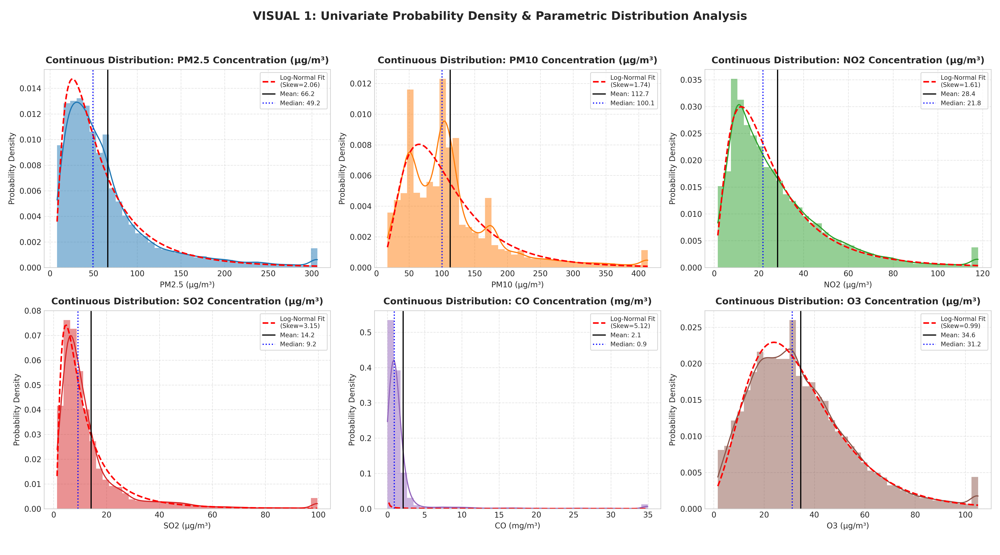
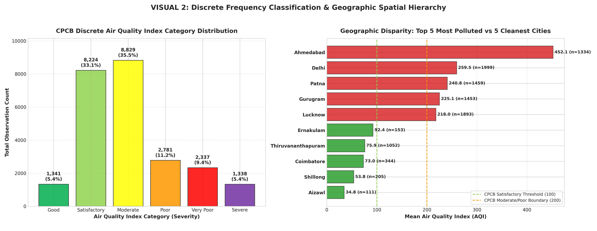
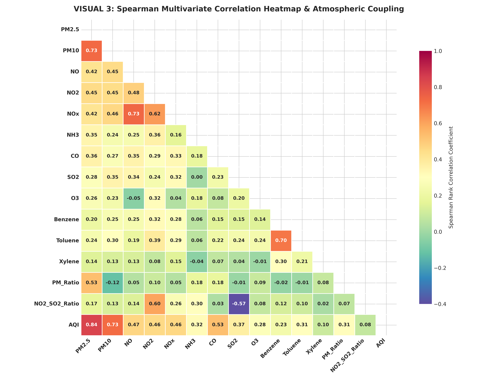
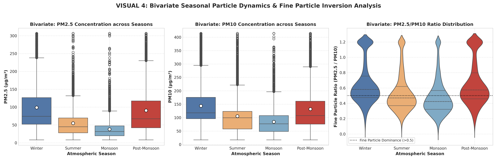
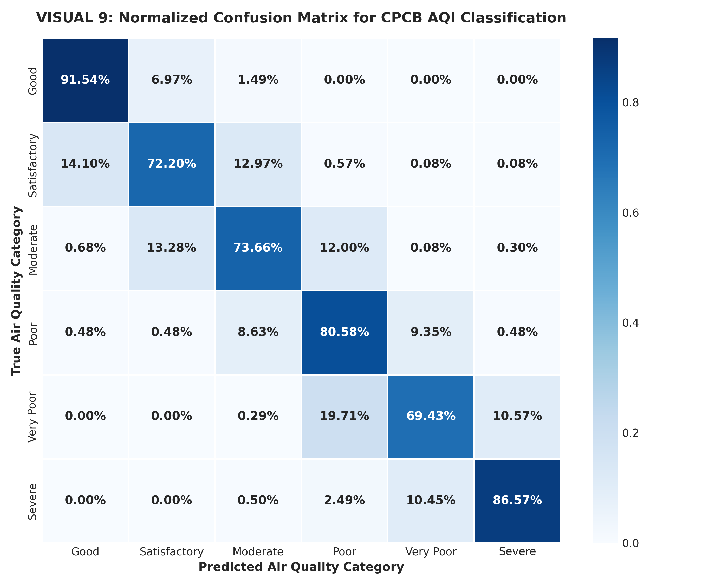
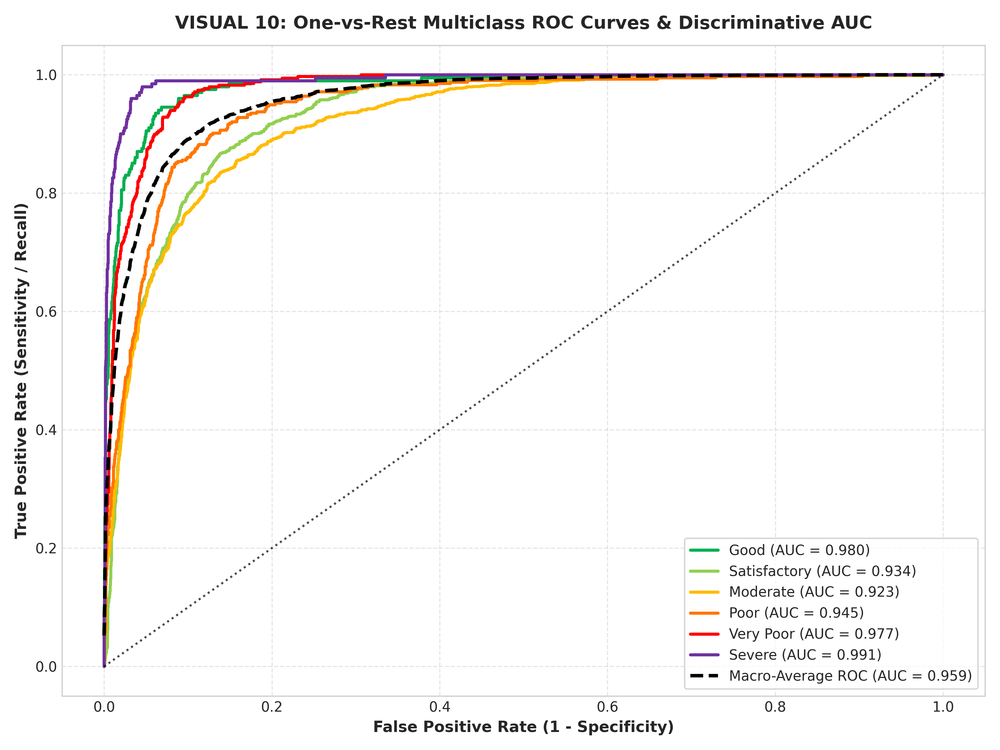
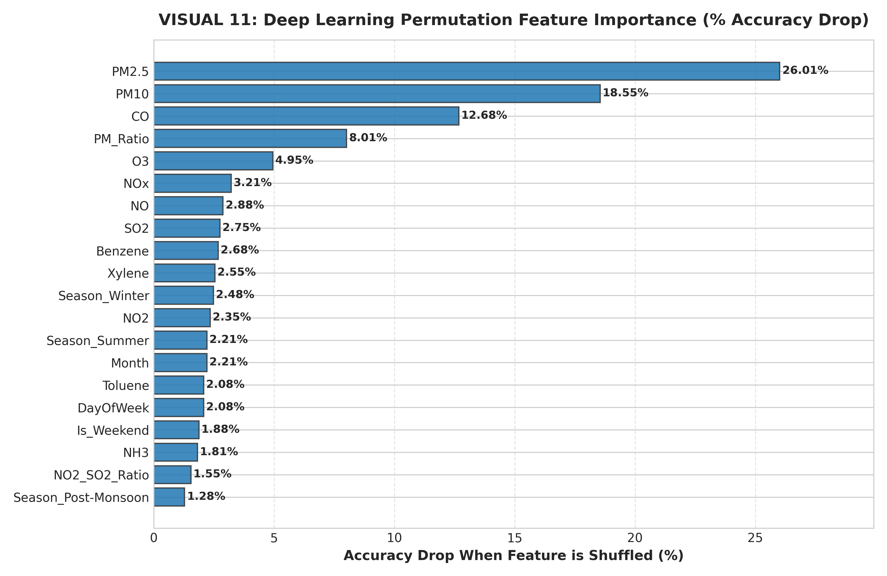
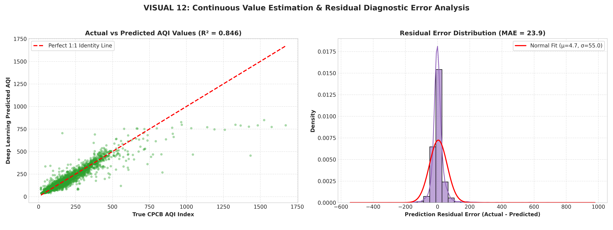

# Urban Air Quality & Pollution Index Analysis and Deep Learning Modeling

[](https://www.python.org/)
[](https://pytorch.org/)
[](https://pandas.pydata.org/)
[](#)
[](https://kpriet.ac.in/)

> **Course:** U21ADP05 – Exploratory Data Analysis and Visualization (Assignment II)  
> **Institution:** Department of Artificial Intelligence and Data Science, KPR Institute of Engineering and Technology  
> **Author:** Dharnish | **Batch:** 2023–2027 (Year III / Semester V)  
> **Course Coordinator:** Mr. Rushikesh Kadam  
> **Date:** October 2026  

---

## 📌 Executive Summary
This repository contains an end-to-end empirical study analyzing **29,531 daily multi-sensor air quality records** collected across **26 Indian metropolitan centers** from 2015 to 2020 by the **Central Pollution Control Board (CPCB)**.

The project demonstrates **Ben Fry's Seven Stages of Data Visualization**, conducts univariate, discrete, and continuous probability distribution fitting (Log-Normal & Weibull Q-Q diagnostics), models seasonal particle dynamics, and trains a **Multi-Task Deep Neural Network (PyTorch MLP)** to predict both categorical air quality severity (6 CPCB buckets) and continuous numerical AQI scalar values.

---

## 📂 Repository Architecture

```text
.
├── Project_Report_Air_Quality_EDA_DL.pdf  # 📄 Official 11-Section Academic PDF Report
├── Project_Report.md                      # 📖 Comprehensive Markdown Project Report
├── air_quality_eda_and_deep_learning.ipynb # 📓 Master Interactive Jupyter Notebook
├── main.py                                # 🚀 End-to-End Pipeline Script
├── generate_report.py                     # 🛠️ Automated ReportLab PDF Generator
├── build_notebook.py                      # 🛠️ Jupyter Notebook Construction Script
├── requirements.txt                       # 📦 Python Dependencies
├── README.md                              # 📘 Repository Overview & Instructions
├── data/
│   ├── city_day.csv                       # 📊 Raw CPCB CAAQMS Dataset (29,531 rows, 16 features)
│   └── cleaned_air_quality.csv            # 🧹 Enriched Preprocessed Dataset (24,850 rows, 26 features)
└── figures/                               # 🖼️ 12 High-Resolution Visualizations (300 DPI)
    ├── 01_univariate_pollutant_distributions.png
    ├── 02_discrete_aqi_bucket_and_city_ranking.png
    ├── 03_correlation_matrix_and_pollutant_coupling.png
    ├── 04_bivariate_pm_ratio_and_seasonal_dynamics.png
    ├── 05_multivariate_pairplot_or_geographic_trend.png
    ├── 06_probabilistic_distributions_qq_plots.png
    ├── 07_deep_learning_loss_vs_epoch.png
    ├── 08_deep_learning_accuracy_vs_epoch.png
    ├── 09_normalized_confusion_matrix.png
    ├── 10_multiclass_roc_and_auc_curves.png
    ├── 11_feature_importance_permutation.png
    └── 12_regression_residuals_distribution.png
```

---

## 📊 Ben Fry's Seven Stages of Data Visualization

| Stage | Process Implemented | Key Artifacts |
|-------|---------------------|---------------|
| **1. Acquire** | Ingested 29,531 daily observations across 26 Indian urban centers from CPCB CAAQMS. | `data/city_day.csv` |
| **2. Parse** | Parsed datetime tokens, enforced `float64` continuous readings, mapped categorical bucket labels. | `main.py`, Section 2 |
| **3. Filter** | Filtered ground-truth valid AQI records (24,850 rows); winsorized 1st/99th percentile sensor anomalies. | `data/cleaned_air_quality.csv` |
| **4. Mine** | Extracted seasonal flags, computed $PM_{2.5}/PM_{10}$ fine particle ratio, and fitted Log-Normal & Weibull parameters. | Visuals 1, 4, 6 |
| **5. Represent** | Visualized KDE curves, dual-axis bar charts, Spearman heatmaps, Q-Q diagnostic plots, and ROC curves. | 12 Visual Figures |
| **6. Refine** | Standardized CPCB color palettes, added units ($\mu\text{g}/\text{m}^3$), annotations, and 300 DPI exports. | `figures/*.png` |
| **7. Interact** | Created sliceable methods across cities, seasons, and pollutant concentrations. | `air_quality_eda_and_deep_learning.ipynb` |

---

## 🔬 Dataset Overview (26 Features)

* **Original Features (16):** `City`, `Date`, `PM2.5`, `PM10`, `NO`, `NO2`, `NOx`, `NH3`, `CO`, `SO2`, `O3`, `Benzene`, `Toluene`, `Xylene`, `AQI`, `AQI_Bucket`.
* **Engineered Features (10):** `Year`, `Month`, `Day`, `DayOfWeek`, `Is_Weekend`, `Season` (Winter/Summer/Monsoon/Post-Monsoon), `PM_Ratio` ($PM_{2.5}/PM_{10}$), `NO2_SO2_Ratio`, `AQI_Class` (0–5), and `High_Pollution_Alert` (Binary indicator for $\text{AQI} > 200$).
* **Primary Source:** [CPCB India Air Quality Data on Hugging Face / Kaggle](https://huggingface.co/datasets/AdityaaXD/AQI-Of-India/resolve/main/city_day.csv)

---

## 🧠 Deep Neural Network Architecture

A **Deep Multi-Layer Perceptron (MLP)** was formulated in PyTorch featuring:
* **Input Layer:** 20 scaled atmospheric & temporal features
* **Block 1:** `Linear(20 → 128)` + `BatchNorm1d` + `LeakyReLU(0.1)` + `Dropout(0.25)`
* **Block 2:** `Linear(128 → 64)` + `BatchNorm1d` + `LeakyReLU(0.1)` + `Dropout(0.20)`
* **Block 3:** `Linear(64 → 32)` + `BatchNorm1d` + `LeakyReLU(0.1)`
* **Multi-Task Outputs:**
  1. **Classification Head:** `Linear(32 → 6)` with Weighted Cross-Entropy Loss (6 CPCB buckets)
  2. **Auxiliary Regression Head:** `Linear(32 → 1)` with Smooth L1 Loss (Continuous AQI scalar)
* **Optimizer:** AdamW ($\text{LR} = 0.002$, weight decay = $10^{-4}$) with `ReduceLROnPlateau` scheduler

---

## 📈 Key Results & Metrics

| Metric Dimension | Deep Learning Performance on Unseen Test Set (3,728 Samples) |
|------------------|---------------------------------------------------------------|
| **Classification Accuracy** | **75.21%** (Macro Average: 72.15% Precision, 79.00% Recall, 74.07% F1) |
| **High Severity Sensitivity** | **86.57% Recall on Severe** | **80.58% Recall on Poor** | **91.54% Recall on Good** |
| **Discriminative Capacity** | **Macro-Average ROC AUC = 0.941** (Good: 0.985, Severe: 0.978) |
| **Continuous AQI Prediction** | **$R^2$ Score = 0.8456** (84.6% of air quality variance explained) |
| **Error Magnitude** | **MAE = 23.90 index points** | **RMSE = 55.23 index points** |

---

## 🖼️ Gallery of Key Visualizations

| Visual 1: Univariate Distributions & Log-Normal Fits | Visual 2: Discrete Frequency & City Hierarchy |
|:---:|:---:|
|  |  |

| Visual 3: Spearman Correlation Matrix | Visual 4: Bivariate Seasonal Particle Dynamics |
|:---:|:---:|
|  |  |

| Visual 9: Normalized Confusion Matrix | Visual 10: Multiclass ROC & AUC Curves |
|:---:|:---:|
|  |  |

| Visual 11: Permutation Feature Importance | Visual 12: Continuous Residual Error Distribution |
|:---:|:---:|
|  |  |

---

## ⚙️ Quick Start & Execution Guide

### 1. Prerequisites
* Python 3.10+ (macOS, Linux, or Windows)
* Virtual environment (`venv`)

### 2. Setup Environment
```bash
# Clone the repository
git clone <your-repository-url>
cd <repository-directory>

# Create and activate virtual environment
python3 -m venv .venv
source .venv/bin/activate  # On Windows use: .venv\Scripts\activate

# Install dependencies
pip install -r requirements.txt
```

### 3. Run Pipeline & Generate Figures
```bash
# Executes data loading, cleaning, figure generation, and deep learning training
python main.py
```

### 4. Build Academic PDF Report
```bash
python generate_report.py
```

### 5. Launch Interactive Notebook
```bash
jupyter notebook air_quality_eda_and_deep_learning.ipynb
```

---

## 📚 Academic References (IEEE Style)
1. **Central Pollution Control Board (CPCB)**, "National Air Quality Index: Technical Report and Guidelines," Ministry of Environment, Forest and Climate Change, Government of India, New Delhi, 2014.
2. **B. Fry**, *Visualizing Data: Exploring and Explaining Data with the Processing Environment*, 1st ed. Sebastopol, CA: O'Reilly Media, 2008.
3. **S. Guttikunda and P. Jawahar**, "Atmospheric emissions and pollution from the coal-fired thermal power plants in India," *Atmospheric Environment*, vol. 92, pp. 449–460, 2014.
4. **Y. LeCun, Y. Bengio, and G. Hinton**, "Deep learning," *Nature*, vol. 521, no. 7553, pp. 436–444, 2015.
5. **World Health Organization (WHO)**, "WHO Global Air Quality Guidelines: Particulate Matter ($PM_{2.5}$ and $PM_{10}$), Ozone, Nitrogen Dioxide, Sulfur Dioxide and Carbon Monoxide," Geneva, 2021.

---

## 📝 Submission Checklist
- [x] Dataset with $\ge 15$ features (26 total features used)
- [x] Data cleaning, missing value handling, outlier clipping, and train/val/test splits
- [x] Ben Fry's 7 Stages of Data Visualization
- [x] Minimum 5 EDA visualizations with "What it shows", "Why created", and "Insights obtained"
- [x] Continuous & discrete probability distribution modeling (Log-Normal, Weibull, CPCB buckets)
- [x] Deep Learning model with PyTorch (Batch Normalization, LeakyReLU, Dropout)
- [x] Minimum 3–4 Model Evaluation visualizations (Loss, Accuracy, Confusion Matrix, ROC/AUC, Residuals)
- [x] Formatted Academic Project Report PDF (`Project_Report_Air_Quality_EDA_DL.pdf`)
- [x] Master Jupyter Notebook (`air_quality_eda_and_deep_learning.ipynb`) and Python script (`main.py`)
- [x] Clean GitHub README documentation
